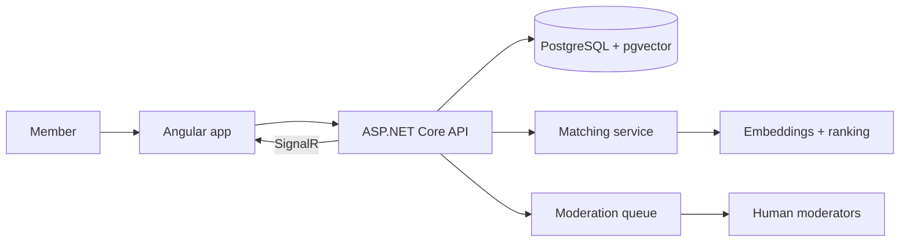

# CircleShift

**Community skill exchange with smart matching.** CircleShift connects adults who want to trade short, practical help, like English conversation, bike repair, résumé reviews or gardening tips, using time credits instead of money.

> **Status:** early development, following a 12-week roadmap (see below). The MVP is for adults only (18+), uses fictional profiles and simulated time credits, and has no real money or precise locations.

## The idea

Social feeds are built to hold attention, not to get things done. CircleShift is built around completed exchanges:

1. A member posts "I can teach React for 45 minutes; I need help with photography"
2. CircleShift finds a matching member whose skills complement theirs
3. Both propose times and confirm a session
4. Both confirm it happened
5. Time credits are earned and spent

The MVP starts with 1:1 matches. Three-way exchange chains are a later goal.

## Who it's for

- **Members:** post offers and requests, and join sessions
- **Coordinators:** host skill circles and approve sessions
- **Moderators:** review reported content
- **Platform admins:** manage community policies

## Planned features

- Accounts, permissions and profile privacy controls
- Skill offers and requests with a shared skill taxonomy
- Availability across time zones, plus invitations
- Session confirmation and a time-credit ledger
- Semantic skill matching with clear "why this match" explanations
- Hard filters the matcher can never override: language, time zone, availability, remote or radius preference, and block lists
- Real-time messaging and status updates
- Safety reporting with AI-assisted moderation: flags with reasons and confidence for human moderators, plus an appeal flow
- Community skill circles and operational analytics

## Tech stack

| Layer | Technology |
|---|---|
| Frontend | Angular, TypeScript, Angular Signals, RxJS |
| Backend | ASP.NET Core, EF Core |
| Real-time | SignalR |
| AI integration | Microsoft.Extensions.AI |
| Database | PostgreSQL with pgvector |
| Cache | Redis |
| Local environment | Docker Compose |

## Architecture

## Design rules

- Blocked users never appear in suggestions.
- The matcher never invents a meeting time.
- Time credits always balance, even when requests are retried.
- Moderation flags are not bans; a person always makes the final decision.
- Real-time status always ends up matching the database.
- No minors, no real geolocation tracking, and no monetary marketplace.

## Roadmap

| Weeks | Focus |
|---|---|
| 1–2 | Community concept, Angular/.NET setup; accounts, permissions and profile privacy |
| 3–5 | Offers, requests and skill taxonomy; time zones and availability; sessions and the time-credit ledger |
| 6–8 | Semantic matching baseline, explained ranking, real-time messaging and first staging |
| 9–10 | Safety reporting with moderation assistance; skill circles and analytics |
| 11–12 | Security, observability and performance; release and scaling plan |

## Getting started

Setup instructions will be added once the first services are in place.
