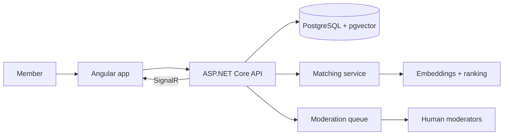

# CircleShift

**Community skill exchange with smart matching.** CircleShift connects adults who want to trade short, practical help, like English conversation, bike repair, résumé reviews or gardening tips, using time credits instead of money.

> **Status:** early development, following an 8-week roadmap (see below). The MVP is for adults only (18+), uses fictional profiles and simulated time credits, and has no real money or precise locations.

## The idea

Social feeds are built to hold attention, not to get things done. CircleShift is built around completed exchanges:

1. A member posts "I can teach React for 45 minutes; I need help with photography"
2. CircleShift finds a matching member whose skills complement theirs
3. Both propose times and confirm a session
4. Both confirm it happened
5. Time credits are earned and spent

The MVP starts with 1:1 matches. Three-way exchange chains are a later goal.

## Who it's for

- **Members:** post offers and requests, and join sessions
- **Coordinators:** host skill circles and approve sessions
- **Moderators:** review reported content
- **Platform admins:** manage community policies

## Planned features

- Accounts, permissions and profile privacy controls
- Skill offers and requests with a shared skill taxonomy
- Availability across time zones, plus invitations
- Session confirmation and a time-credit ledger
- Semantic skill matching with clear "why this match" explanations
- Hard filters the matcher can never override: language, time zone, availability, remote or radius preference, and block lists
- Real-time messaging and status updates
- Safety reporting with AI-assisted moderation: flags with reasons and confidence for human moderators, plus an appeal flow
- Community skill circles and operational analytics

## Tech stack

| Layer | Technology |
|---|---|
| Frontend | Angular, TypeScript, Angular Signals, RxJS |
| Backend | ASP.NET Core, EF Core |
| Real-time | SignalR |
| AI integration | Microsoft.Extensions.AI |
| Database | PostgreSQL with pgvector |
| Cache | Redis |
| Local environment | Docker Compose |

## Architecture

## Design rules

- Blocked users never appear in suggestions.
- The matcher never invents a meeting time.
- Time credits always balance, even when requests are retried.
- Moderation flags are not bans; a person always makes the final decision.
- Real-time status always ends up matching the database.
- No minors, no real geolocation tracking, and no monetary marketplace.

## Roadmap

| Week | Focus | Status |
|---|---|---|
| Week 1 | **Community concept & Angular/.NET bootstrap** — Add community rules, personas, ADR 0001 and Angular app shell, bootstrap ASP.NET Core API with health route, EF Core and Compose | Planned |
| Week 2 | **Accounts, permissions & profile privacy** — Add member profiles, roles and authorization policies, add Angular onboarding, profile editor and visibility and block API | Planned |
| Week 3 | **Offers, requests, availability & invitations** — Add skill catalog, offers, requests and Angular feed, add IANA availability windows, exchange states and slot suggestions, add Angular invitation panel and weekly availability editor | Planned |
| Week 4 | **Session confirmation & time-credit ledger** — Add session confirmations and credit journal models, add idempotent time-credit settlement and wallet history | Planned |
| Week 5 | **Semantic matching & explained ranking** — Add hard filters, keyword baseline and Angular match cards, add embedding provider adapter with mock fallback and re-embedding worker, add compare-match drawer and ranking feedback | Planned |
| Week 6 | **Real-time messaging & first staging** — Add conversations, messages and authenticated SignalR hub, add cursor history, outbox delivery and Angular message thread | Planned |
| Week 7 | **Safety moderation, circles & analytics** — Add reports, moderation cases, appeals and moderator queue, add circles, event reservations and aggregate metrics, add Angular circle event page and activity dashboard | Planned |
| Week 8 | **Security, observability & release** — Audit block checks and add metrics, logs and traces, run security and concurrency checks and rehearse restore, finalize acceptance matrix, demo seed and changelog, ship HTTPS demo and verify SignalR reverse proxy | Planned |

## Documentation

- [Community rules](docs/community-policy/community-rules.md): adult-only scope, allowed skills, privacy and moderation
- [Personas](docs/product/personas.md) and permission summary
- [Exchange lifecycle](docs/domain/exchange-lifecycle.md): states, time-credit settlement and time zones
- [ADR 0001](docs/adr/0001-angular-dotnet-modular-monolith.md): Angular front end and a modular ASP.NET Core monolith

## Getting started

Setup instructions will be added once the first services are in place.
