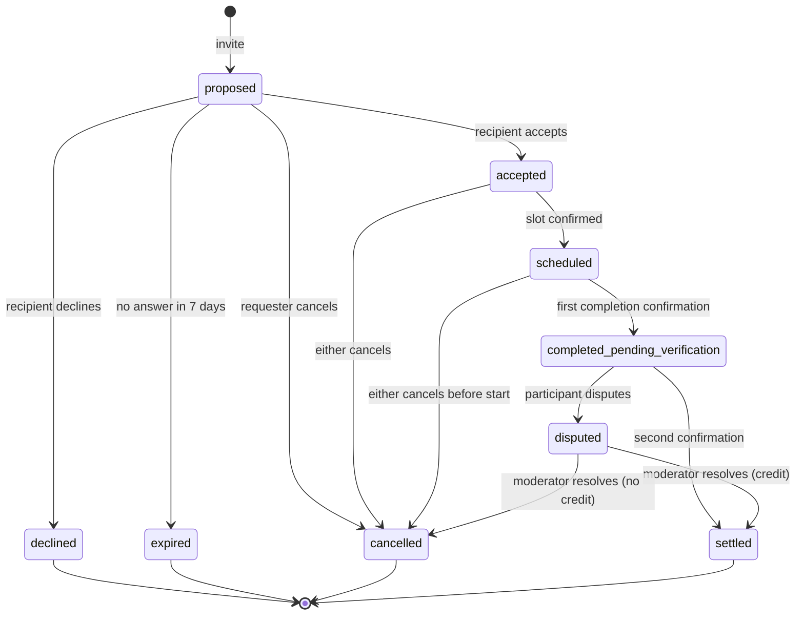

# Skill exchange lifecycle

This document describes how an exchange moves from an invitation to settled time credits. The API owns every transition; the Angular app and SignalR only display the state stored in PostgreSQL.

## Happy path

1. Laura publishes an **offer** ("React mentoring, 45 min") and a **request** ("portrait photography").
2. Tomás finds Laura through search or a match suggestion and sends an **invitation** linked to her post.
3. Laura **accepts**. Both propose time slots inside their weekly availability.
4. One proposed slot is **confirmed** as a session. A member can never hold two confirmed sessions that overlap.
5. After the session, **both** participants confirm completion.
6. The ledger **settles** the session once: the provider earns the minutes, the recipient spends them.

## Exchange states

- `declined`, `expired`, `cancelled` and `settled` are terminal.
- `disputed` keeps credits **unsettled** until a human moderator resolves it.
- Every transition carries the exchange's `revision`; a stale revision returns `409 Conflict`.
- An invitation is rejected if either member has blocked the other.

## Time-credit settlement

For a session of `d` minutes between provider `P` and recipient `R`, settlement posts one balanced journal:

| Account | Delta |
|---|---|
| `P` | `+d` |
| `R` | `−d` |

- The sum of deltas in every journal is `0`.
- A session can be settled only once: the ledger has a unique key on `(session_id, posting_type)`, and settlement requests carry an idempotency key. Retries return the original journal.
- A recipient's balance cannot go below zero. New members get an explicit `bootstrap_grant` journal (labelled in the wallet history), never a hidden starting balance.

## Times and time zones

- Weekly availability is stored as local times plus an IANA zone (for example `America/Bogota`, `Europe/Madrid`).
- Confirmed sessions are stored in UTC and shown in each participant's own zone.
- Slots that do not exist or are ambiguous because of a daylight-saving change are rejected or flagged; the system never guesses.
